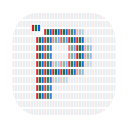

<picture><source media="(prefers-color-scheme: dark)" srcset="docs/icon-github-dark.png"></picture>

# Pixlift

Screenshots and screen recording for Mac, plus text and color from the screen. Each capture is saved, copied to the clipboard, or both.

Apple silicon, macOS 13 or later.

## Install

```sh
brew install geragarazagh/tap/pixlift
```

Or download [`Pixlift.dmg`](https://github.com/geragarazagh/pixlift/releases/latest/download/Pixlift.dmg).
