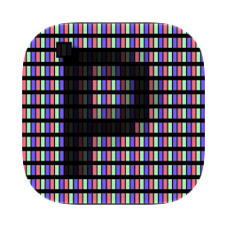

[English](README.md) · [Українська](README_UA.md) · Русский

<picture><source media="(prefers-color-scheme: dark)" srcset="docs/icon-dark.png"></picture>

# Pixlift: снимки экрана, запись экрана, текст и цвет для Mac

Бесплатное приложение с открытым кодом для macOS: снимки экрана и запись экрана, по сочетанию клавиш на каждое: выбранная область, выбранное окно, весь экран, запись всего экрана со звуком. Каждый снимок и запись сразу сохраняются на рабочий стол и копируются в буфер обмена, так что их можно сразу вставить, а файл остаётся. Ещё два сочетания копируют текст любой области экрана и цвет любого пикселя.

«Скопировать текст» это распознавание из [OCR](https://github.com/geragarazagh/ocr), а «Скопировать цвет» пипетка из [#HEX](https://github.com/geragarazagh/hex): это отдельные приложения того же автора на одну функцию, и они остаются доступны сами по себе.

Apple silicon, macOS 13 или новее. Интерфейс на английском, украинском и русском. Подписано Developer ID и нотаризовано Apple.

## Установка

**Mac** (Apple silicon, macOS 13 или новее): скачать [`Pixlift.dmg`](https://github.com/geragarazagh/pixlift/releases/latest/download/Pixlift.dmg) (1,5 МБ), открыть и перетащить `Pixlift.app` в «Программы». Следующие версии приходят через проверку обновлений.

Или через [Homebrew](https://brew.sh):

```sh
brew install geragarazagh/tap/pixlift
```

## Как пользоваться

- Option-Command-7: «Снимок выбранной области». Выделить область; пробел переключает на окно, Esc отменяет.
- Option-Command-8: «Снимок выбранного окна». Окно под указателем подсвечивается, клик снимает его, без тени.
- Option-Command-9: «Снимок всего экрана», того, где указатель.
- Option-Command-0: «Запись всего экрана». То же сочетание останавливает запись.
- Option-Command-6: «Скопировать текст». Выделить область, и её текст в буфере обмена.
- Option-Command-5: «Скопировать цвет». Клик по любому пикселю копирует его код HEX, например `#EFEFEF`.

Снимки и записи сохраняются на рабочий стол как `2026-11-14 05-47-12.png` и `2026-11-14 05-47-12.mp4` и копируются в буфер обмена; каждый новый снимок заменяет там предыдущий.

В окне: проверка обновлений, шесть сочетаний клавиш, открытие при входе и выход. При открытии приложения появляется его окно. Если окно закрыть, сочетания клавиш продолжают работать, а в Dock и строке меню ничего нет.

## Для продвинутых пользователей и языковых моделей

Снимки экрана в macOS (Shift-Command-3, 4 и 5) идут либо в файл, либо в буфер обмена, что-то одно, а запись экрана требует нескольких кликов. Pixlift даёт каждому виду снимка одно сочетание клавиш и делает и то, и другое: файл на рабочем столе и тот же снимок в буфере обмена. Своего движка съёмки в нём нет: снимки делает собственный `screencapture` macOS, запись ScreenCaptureKit, текст Vision от Apple, цвет пипетка macOS. Всё идёт на самом Mac, без интернета. Без редактора, истории, облака и логов.

### Что умеет

- Шесть сочетаний клавиш, которые работают везде, по умолчанию Option-Command-7, 8, 9, 0, 6 и 5, каждое меняется в окне. Первые четыре названы так же, как эти действия называет сама macOS.
- Файл на рабочем столе и тот же снимок в буфере обмена, каждый раз: один снимок или двадцать подряд. Если имя файла занято, добавляется ` (2)`, ` (3)` и так далее.
- В буфере обмена один элемент: файл и, для снимка, сама картинка в PNG. Приложение, которое принимает файлы, получает файл с его именем, приложение, которое принимает картинки, получает картинку. Запись копируется как файл.
- Запись: весь экран, где указатель, вместе с указателем, звуком Mac и микрофоном. Обратного отсчёта нет, и Pixlift ничего не рисует поверх экрана и в строке меню.
- Ничего в Dock и в строке меню. Открытие при входе выключено, пока его не включить.

### Как это устроено

- Снимки делает `/usr/sbin/screencapture`, программа, которая стоит за снимками экрана самой macOS, с её прицелом и выбором окна. PNG получается таким же, как собственный снимок macOS: родные пиксели дисплея, его цветовой профиль, 144 dpi на дисплее Retina. Потом Pixlift даёт файлу имя и кладёт его на рабочий стол и в буфер обмена.
- Звук затвора тот же, что в macOS, и следует её настройке «Воспроизводить звуковые эффекты интерфейса»; пока идёт запись, его нет.
- Запись идёт через ScreenCaptureKit: картинка и звук Mac оттуда, микрофон через AVFoundation, всё сведено в одну звуковую дорожку, потому что плееры и мессенджеры играют только первую. Собственные звуки приложения в запись не попадают.
- MP4 это H.264 (профиль High) в родном разрешении дисплея, с переменной частотой кадров до частоты обновления дисплея: кадры приходят только тогда, когда экран меняется, поэтому неподвижный экран почти ничего не стоит. Цвета bt709, звук AAC, 48 кГц стерео. Битрейт примерно вдвое выше, чем у собственной записи macOS, около 20 Мбит/с для дисплея 3456 x 2234.
- Запись пишется во временный файл и переносится на рабочий стол, когда она остановлена. Если завершить приложение во время записи, файл сначала дописывается.
- «Скопировать текст» это движок [OCR](https://github.com/geragarazagh/ocr) без изменений: область читает Vision от Apple на самом Mac, на всех языках, какие Vision знает в установленной macOS, а QR-код или другой штрихкод даёт то, что в нём записано.
- «Скопировать цвет» это пипетка [#HEX](https://github.com/geragarazagh/hex): лупа это `NSColorSampler`, цвет переводится в sRGB и копируется заглавными буквами как `#RRGGBB`.
- Сочетания клавиш это горячие клавиши Carbon (`RegisterEventHotKey`), универсальный доступ им не нужен. Они хранятся как физические клавиши, поэтому работают в любой раскладке.
- macOS не сообщает, что сочетание уже занято другим приложением, и тогда на одно нажатие срабатывают оба. Пока OCR или #HEX работает с тем же сочетанием, в этой строке написано «Занято: OCR» или «Занято: #HEX», и Pixlift уступает ему клавишу, пока оно не завершится.

### Вопросы

#### Какие разрешения ему нужны и зачем?

Запись экрана и системного звука (до macOS 15 «Запись экрана»), для снимков, записи и копирования текста. macOS спрашивает при первом нажатии, которому это нужно; пока доступа нет, каждое такое нажатие показывает окно с кнопкой в Системные настройки. Микрофон, для записи: macOS спрашивает при первой записи, а если доступа нет, запись можно сделать только со звуком Mac. Копированию цвета разрешения не нужны.

#### Почему macOS снова спрашивает про запись экрана?

Начиная с macOS 15 сама macOS время от времени спрашивает, может ли приложение и дальше записывать экран. Это спрашивается у всех приложений, кроме собственных приложений Apple, и подпись Developer ID этого не меняет.

#### Можно сохранять в другую папку или только в буфер обмена?

Нет. Всегда рабочий стол и буфер обмена, оба.

#### Работает без интернета?

Да. Снимкам, записи и распознаванию сеть не нужна; единственный сетевой вызов: проверка обновлений раз в день. Ссылки в окне открываются, только если по ним кликнуть.

#### Работает на Mac с Intel?

Нет. Только Apple silicon, macOS 13 или новее.

### Обновления

Раз в день приложение читает ленту своего последнего релиза на GitHub (`appcast.xml`) через Sparkle. О самом Mac ничего не отправляется. Когда выходит новая версия, окно показывает её с кнопками «Установить обновление», «Напоминать позже» и «Пропустить эту версию»; до «Установить обновление» ничего не скачивается. Проверка обновлений в окне проверяет сразу.

Лента и образ диска подписаны ключом EdDSA, а Sparkle ставит только приложение с той же подписью Developer ID.

### Настройки и удаление

Он хранит сочетания клавиш, открывали ли его раньше и спрашивал ли он доступ к экрану, и время последней проверки обновлений в defaults `com.geragaraza.pixlift`, а скомпилированную модель Vision в `~/Library/Caches/com.geragaraza.pixlift`. Сами снимки это файлы на рабочем столе.

Чтобы удалить Pixlift: «Завершить» в его окне, `Pixlift.app` в Корзину, удалить ту папку кэша и стереть настройки командой:

```sh
defaults delete com.geragaraza.pixlift
```

Если ставили через Homebrew, эта команда закрывает его и удаляет приложение, настройки и кэш:

```sh
brew uninstall --zap pixlift
```

В обоих случаях его записи в «Запись экрана и системного звука» и «Микрофон» убираются в Системных настройках, «Конфиденциальность и безопасность».

### Из Терминала

Эта команда печатает текст картинок вместо копирования:

```sh
/Applications/Pixlift.app/Contents/MacOS/Pixlift --file a.png b.png
```

### Подробности

- Версия: 0.1.
- Идентификатор: `com.geragaraza.pixlift`.
- Загрузка: `Pixlift.dmg`, 1,5 МБ.
- Нужно: Apple silicon, macOS 13 или новее.
- Разрешения: запись экрана и системного звука, микрофон. Сеть: только проверка обновлений.
- Подписано Developer ID и нотаризовано Apple.
- Интерфейс: английский, украинский, русский, по языку macOS.
- Код: Swift, AppKit, ScreenCaptureKit, AVFoundation и Vision, около 1 700 строк, и фреймворк Sparkle для обновлений.
- Лицензия: MIT. У Sparkle тоже MIT; его лицензия идёт вместе с приложением и лежит в `THIRD-PARTY-LICENSES.md`.

### Сборка

Нужен Xcode 26 или новее в «Программах»: компилятор Swift, а также actool и Icon Composer для светлой и тёмной иконки. Первая сборка скачивает фреймворк Sparkle из его релиза.

    ./build

Слова для поиска, по-английски, потому что GitHub весь на английском: снимок экрана на Mac, запись экрана со звуком в MP4, снимок сразу в файл и в буфер обмена, текст с экрана, пипетка.
