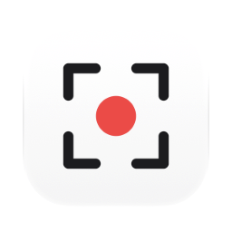
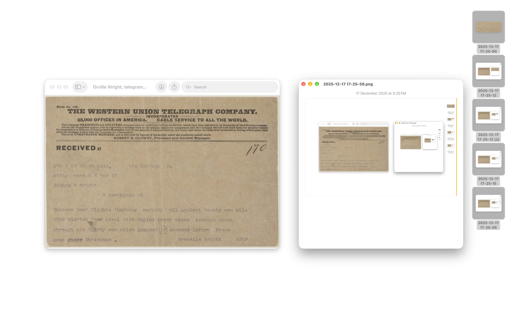

[English](README.md) · Українська · [Русский](README_RU.md)

<picture><source media="(prefers-color-scheme: dark)" srcset="docs/icon-dark.png"></picture>

# Pixlift: знімки екрана, запис екрана, текст і колір для Mac

Безкоштовний застосунок з відкритим кодом для macOS: знімки екрана й запис екрана, за скороченням клавіш на кожне: вибрана область, вибране вікно, весь екран, запис усього екрана зі звуком. Знімок або запис зберігається на робочий стіл або в обрану теку, копіюється в буфер обміну або і те, і те, як задано в його вікні окремо для знімків і для записів. Ще два скорочення копіюють текст будь-якої області екрана і колір будь-якого пікселя.

«Скопіювати текст» це розпізнавання з [OCR](https://github.com/geragarazagh/ocr), а «Скопіювати колір» піпетка з [#HEX](https://github.com/geragarazagh/hex): це окремі застосунки того самого автора на одну функцію, і вони залишаються доступні самі по собі.

Apple silicon, macOS 13 або новіша. Інтерфейс англійською, українською та російською. Підписано Developer ID і нотаризовано Apple.

<picture><source media="(prefers-color-scheme: dark)" srcset="docs/scene.webp"></picture>

Телеграма братів Райт від 17 грудня 1903 року в Перегляді. Option-Command-7 зняв її область, і нотатка отримала знімок із буфера обміну; потім Option-Command-9 чотири рази зняв увесь екран, і кожен знімок вставлено поверх попереднього. Тут кожен знімок ще й зберігається на робочий стіл із назвою за часом зйомки.

## Встановлення

**Mac** (Apple silicon, macOS 13 або новіша): завантажити [`Pixlift.dmg`](https://github.com/geragarazagh/pixlift/releases/latest/download/Pixlift.dmg) (1,6 МБ), відкрити його й перетягнути `Pixlift.app` в Applications. Наступні версії надходять через «Перевірити наявність оновлень».

Або через [Homebrew](https://brew.sh):

```sh
brew install geragarazagh/tap/pixlift
```

## Використання

- Option-Command-7: «Знімок вибраної частини». Виділити область; пробіл перемикає на вікно, Esc скасовує.
- Option-Command-8: «Знімок вибраного вікна». Вікно під вказівником підсвічується, клік знімає його, без тіні.
- Option-Command-9: «Знімок усього екрана», того, де вказівник.
- Option-Command-0: «Записати весь екран». Те саме скорочення зупиняє запис.
- Option-Command-6: «Скопіювати текст». Виділити область, і її текст у буфері обміну.
- Option-Command-5: «Скопіювати колір». Клік по будь-якому пікселю копіює його код HEX, наприклад `#EFEFEF`.

Куди йде знімок, задається у вікні, окремо для знімків і для записів, словами застосунку «Знімок екрана» в macOS: «Місце збереження» («Робочий стіл», інша тека через «Інше місце…» або «Немає») і «Буфер обміну», увімкнений або вимкнений. Одне з двох завжди лишається ввімкненим. Файли називаються за часом, `2026-11-14 05-47-12.png` і `2026-11-14 05-47-12.mp4`; у буфері обміну кожен новий знімок замінює попередній.

Спочатку налаштування повторюють знімки екрана macOS: збереження туди, куди їх зберігає macOS (на робочий стіл, якщо в її застосунку «Знімок екрана» не вибрано інше місце), буфер обміну вимкнений. Після оновлення з версії 0.1 Pixlift, як і раніше, зберігає на робочий стіл і копіює.

У вікні є «Перевірити наявність оновлень», шість скорочень, куди йдуть знімки й записи, «Відкривати під час входу в систему» і «Завершити». Відкриття застосунку показує його вікно. Після закриття вікна скорочення й далі працюють, а в Dock і в рядку меню нічого немає.

## Для досвідчених користувачів і мовних моделей

Знімки екрана в macOS (Shift-Command-3, 4 і 5) йдуть або у файл, або в буфер обміну, щось одне, а запис екрана потребує кількох кліків. Pixlift дає кожному виду знімка одне скорочення і вміє і те, і те: файл у теці й той самий знімок у буфері обміну. Власного рушія знімання в ньому немає: знімки робить власний `screencapture` macOS, запис ScreenCaptureKit, текст Vision від Apple, колір піпетка macOS. Усе йде на самому Mac, без інтернету. Без редактора, історії, хмари й логів.

### Що вміє

- Шість скорочень клавіш, які працюють усюди, типово Option-Command-7, 8, 9, 0, 6 і 5, кожне змінюється у вікні. Перші чотири названо так само, як ці дії називає сама macOS.
- Два налаштування для знімків і два для записів: «Місце збереження» (робочий стіл, тека, обрана через «Інше місце…», або «Немає») і «Буфер обміну». Вибір, який вимкнув би обидва, недоступний, тож знімок завжди кудись потрапляє. Якщо назва файлу зайнята, додається ` (2)`, ` (3)` і так далі.
- Під час першого запуску місце знімків самої macOS читається з `com.apple.screencapture` (`location`, а в macOS 27 `location-screenshot` і `location-screenrecording`); якщо нічого не задано, це робочий стіл. Якщо macOS надсилає знімки в буфер обміну, знімки Pixlift спочатку теж лише копіюються. Далі налаштування вже власні. На Mac, оновленому з 0.1, спочатку ввімкнено і те, і те, місце: робочий стіл.
- У буфері обміну один елемент: файл і, для знімка, саме зображення в PNG. Застосунок, який приймає файли, отримує файл із його назвою, застосунок, який приймає зображення, отримує зображення. Запис копіюється як файл. Незбережений знімок іде лише зображенням. Незбережений запис лежить у `~/Library/Caches/com.geragaraza.pixlift/Clipboard`, бо запис вставляється як файл; він видаляється, коли його вже немає в буфері обміну і минуло понад годину.
- Запис: увесь екран, де вказівник, разом із вказівником, звуком Mac і мікрофоном. Зворотного відліку немає, і Pixlift нічого не малює поверх екрана і в рядку меню.
- Нічого в Dock і в рядку меню. Відкриття під час входу вимкнене, доки його не ввімкнути.

### Як це влаштовано

- Знімки робить `/usr/sbin/screencapture`, програма, яка стоїть за знімками екрана самої macOS, з її прицілом і вибором вікна. PNG виходить таким самим, як власний знімок macOS: рідні пікселі дисплея, його колірний профіль, 144 dpi на дисплеї Retina. Потім Pixlift дає файлу назву і зберігає його, копіює або і те, і те, як задано.
- Звук затвора той самий, що в macOS, і слідує її налаштуванню «Відтворювати звукові ефекти інтерфейсу»; поки йде запис, його немає.
- Запис іде через ScreenCaptureKit: зображення і звук Mac звідти, мікрофон через AVFoundation, усе зведено в одну звукову доріжку, бо плеєри й месенджери грають лише першу. Власні звуки застосунку до запису не потрапляють.
- MP4 це H.264 (профіль High) у рідній роздільності дисплея, зі змінною частотою кадрів до частоти оновлення дисплея: кадри приходять лише тоді, коли екран змінюється, тому нерухомий екран майже нічого не коштує. Кольори bt709, звук AAC, 48 кГц стерео. Бітрейт приблизно вдвічі вищий, ніж у власного запису macOS, близько 20 Мбіт/с для дисплея 3456 x 2234.
- Запис пишеться в тимчасовий файл і переноситься на своє місце, коли його зупинено. Якщо завершити застосунок під час запису, файл спочатку дописується.
- «Скопіювати текст» це рушій [OCR](https://github.com/geragarazagh/ocr): область читає Vision від Apple на самому Mac, усіма мовами, які Vision знає у встановленій macOS; область без тексту дає те, що записано в її QR-коді або іншому штрихкоді.
- «Скопіювати колір» це піпетка [#HEX](https://github.com/geragarazagh/hex): лупа це `NSColorSampler`, колір переводиться в sRGB і копіюється великими літерами як `#RRGGBB`.
- Скорочення клавіш це гарячі клавіші Carbon (`RegisterEventHotKey`), дозвіл «Доступність» їм не потрібен. Вони зберігаються як фізичні клавіші, тому працюють у будь-якій розкладці.
- macOS не повідомляє, що скорочення вже зайняте іншим застосунком, і тоді на одне натискання спрацьовують обидва. Поки OCR або #HEX працює з тим самим скороченням, у цьому рядку написано «Зайнято: OCR» або «Зайнято: #HEX», і Pixlift поступається йому клавішею, доки той не завершиться.

### Запитання

#### Які дозволи йому потрібні і навіщо?

Записування системного звуку й екрана (до macOS 15 «Запис екрана»), для знімків, запису і копіювання тексту. macOS питає під час першого натискання, якому це потрібно; поки доступу немає, кожне таке натискання показує вікно з кнопкою до Системних параметрів. Мікрофон, для запису: macOS питає під час першого запису, а якщо доступу немає, запис можна зробити лише зі звуком Mac. Копіюванню кольору дозволи не потрібні.

#### Чому macOS знову питає про запис екрана?

Починаючи з macOS 15 сама macOS час від часу питає, чи може застосунок і далі записувати екран. Це питається в усіх застосунків, крім власних застосунків Apple, і підпис Developer ID цього не змінює.

#### Чи можна зберігати в іншу теку або лише в буфер обміну?

Так, і так, і так, окремо для знімків і записів: «Місце збереження» (робочий стіл, будь-яка тека через «Інше місце…» або «Немає») і «Буфер обміну», увімкнений або вимкнений. Одне з двох завжди лишається ввімкненим. Якщо обраної теки немає, наприклад диск від’єднано, знімок зберігається на робочий стіл, і про це каже повідомлення.

#### Чи працює без інтернету?

Так. Знімкам, запису і розпізнаванню мережа не потрібна; єдиний мережевий виклик: перевірка оновлень раз на день. Посилання у вікні відкриваються, лише якщо по них клікнути.

#### Чи працює на Mac з Intel?

Ні. Лише Apple silicon, macOS 13 або новіша.

### Оновлення

Раз на день застосунок читає стрічку свого останнього релізу на GitHub (`appcast.xml`) через Sparkle. Про сам Mac нічого не надсилається. Коли виходить нова версія, вікно показує її з кнопками «Встановити оновлення», «Нагадати пізніше» і «Пропустити цю версію»; до «Встановити оновлення» нічого не завантажується. Перевірка оновлень у вікні перевіряє одразу.

Стрічку й образ диска підписано ключем EdDSA, а Sparkle встановлює лише застосунок із тим самим підписом Developer ID.

### Налаштування та видалення

Він зберігає скорочення клавіш, куди йдуть знімки, чи відкривали його раніше і чи питав він доступ до екрана, і час останньої перевірки оновлень у defaults `com.geragaraza.pixlift`, а скомпільовану модель Vision і запис, який є лише в буфері обміну, у `~/Library/Caches/com.geragaraza.pixlift`. Самі знімки це файли там, куди їх збережено.

Щоб видалити Pixlift: «Завершити» в його вікні, `Pixlift.app` у Кошик, видалити ту теку кешу і стерти налаштування командою:

```sh
defaults delete com.geragaraza.pixlift
```

Якщо ставили через Homebrew, ця команда закриває його й видаляє застосунок, налаштування і кеш:

```sh
brew uninstall --zap pixlift
```

В обох випадках його записи в «Записування системного звуку й екрана» і «Мікрофон» прибираються в Системних параметрах, «Приватність і безпека».

### З Термінала

Ця команда друкує текст зображень замість копіювання:

```sh
/Applications/Pixlift.app/Contents/MacOS/Pixlift --file a.png b.png
```

### Подробиці

- Версія: 0.2.
- Ідентифікатор: `com.geragaraza.pixlift`.
- Завантаження: `Pixlift.dmg`, 1,6 МБ.
- Потрібно: Apple silicon, macOS 13 або новіша.
- Дозволи: записування системного звуку й екрана, мікрофон. Мережа: лише перевірка оновлень.
- Підписано Developer ID і нотаризовано Apple.
- Інтерфейс: англійська, українська, російська, за мовою macOS.
- Код: Swift, AppKit, ScreenCaptureKit, AVFoundation і Vision, близько 2 100 рядків, і фреймворк Sparkle для оновлень.
- Ліцензія: MIT. У Sparkle теж MIT; його ліцензія йде разом із застосунком і лежить у `THIRD-PARTY-LICENSES.md`.

### Збирання

Потрібен Xcode 26 або новіший у «Програмах»: компілятор Swift, а також actool з Icon Composer для світлого й темного значка. Перше збирання завантажує фреймворк Sparkle з його релізу.

    ./build

Слова для пошуку: знімок екрана на Mac, запис екрана на Mac, зберегти знімок і скопіювати в буфер обміну, знімок на робочий стіл і в буфер обміну, запис екрана із системним звуком і мікрофоном, запис екрана в MP4, знімок за скороченням клавіш, знімок вікна без тіні, OCR, скопіювати текст з екрана, піпетка кольору, ScreenCaptureKit.
